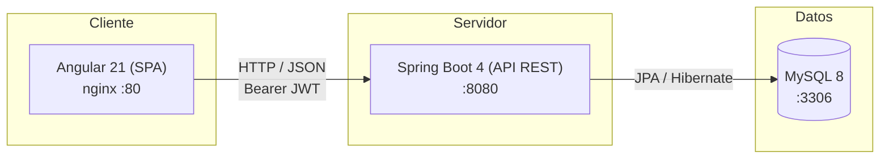

# Lista de Deseos — E-commerce B2C Carvajal

Módulo de **lista de deseos** para el e-commerce B2C de Carvajal: el cliente ve el catálogo con las existencias reales, arma su lista, es notificado cuando un deseo se queda sin stock, y todo movimiento queda guardado en un histórico.

Prueba técnica · Desarrollador Full Stack Expert.

---

## Contenido

- [Stack](#stack)
- [Arquitectura](#arquitectura)
- [Cómo levantarlo](#cómo-levantarlo)
- [Credenciales](#credenciales)
- [Scripts de base de datos](#scripts-de-base-de-datos)
- [API REST](#api-rest)
- [Pruebas](#pruebas)
- [Cómo se resolvió cada requisito](#cómo-se-resolvió-cada-requisito)
- [Decisiones técnicas](#decisiones-técnicas)
- [Estructura del proyecto](#estructura-del-proyecto)
- [Estrategia de ramificación](#estrategia-de-ramificación)

---

## Stack

| Capa | Tecnología | Por qué |
|---|---|---|
| Runtime | **Java 21** (LTS) | Spring Boot 4 exige mínimo 17 y recomienda 21 |
| Backend | **Spring Boot 4.0.x** | Spring Boot 3.5 salió de soporte OSS el 30-jun-2026 |
| Persistencia | **Spring Data JPA + Hibernate** | La capa ORM que pide la prueba |
| Base de datos | **MySQL 8** | Justificación en [`docs/modelo-base-datos.md`](docs/modelo-base-datos.md) |
| Migraciones | **Flyway** | Esquema versionado y reproducible |
| Seguridad | **Spring Security + JWT** (Nimbus) | Sin librerías externas de JWT |
| Documentación | **springdoc-openapi v3** | La v3 es la compatible con Spring Boot 4 |
| Frontend | **Angular 21** | SPA con componentes standalone y signals |
| Contenedores | **Docker + Docker Compose** | Los tres servicios con un comando |

---

## Arquitectura

Arquitectura **cliente-servidor**: una SPA de Angular consume una API REST de Spring Boot, que es la única que habla con la base de datos.



**Toda la lógica de negocio vive en el servidor.** El estado de stock de cada deseo se calcula en la capa de servicio y llega resuelto al cliente; Angular solo lo pinta. Eso es deliberado: la prueba exige que la lógica de negocio se implemente mediante API-REST.

El backend es un **monolito modular**: cada paquete de primer nivel (`catalog`, `wishlist`, `auth`, `shared`) es un módulo con su propio dominio, repositorio, servicio y controlador. Ver [Decisiones técnicas](#sobre-microservicios).

---

## Cómo levantarlo

### Opción A — Docker Compose (recomendada)

Lo único que necesitas instalado es Docker.

```bash
git clone <url-del-repositorio>
cd carvajal-wishlist
docker compose up --build
```

La primera vez tarda unos minutos (compila el backend con Maven y la SPA con Node). Cuando termine:

| | URL |
|---|---|
| **Aplicación** | <http://localhost:4200> |
| API | <http://localhost:8080/api/v1/products> |
| **Swagger UI** | <http://localhost:8080/swagger-ui.html> |
| MySQL | `localhost:3306` |

El backend espera a que MySQL responda de verdad (healthcheck), y Flyway crea el esquema y carga los datos simulados automáticamente al arrancar. No hay que ejecutar ningún script a mano.

Para bajarlo todo:

```bash
docker compose down          # conserva los datos
docker compose down -v       # borra también la base de datos
```

### Opción B — Local, sin Docker

**Requisitos:** JDK 21, Maven 3.9+, Node 20.19+ / 22.12+ / 24+, **npm 11+** y MySQL 8.

> **Ojo con npm:** npm 10.9.x tiene un bug resolviendo peer dependencies (`Cannot read properties of null (reading 'edgesOut')`) que rompe el `npm install` de este proyecto. Si lo ves, actualiza con `npm install -g npm@11`.

**1. Crear la base de datos y el usuario**

```sql
CREATE DATABASE carvajal_wishlist
  CHARACTER SET utf8mb4
  COLLATE utf8mb4_0900_ai_ci;

CREATE USER 'wishlist_user'@'localhost' IDENTIFIED BY 'Wishlist2026*';
GRANT ALL PRIVILEGES ON carvajal_wishlist.* TO 'wishlist_user'@'localhost';
FLUSH PRIVILEGES;
```

No hay que crear tablas: Flyway lo hace al arrancar el backend.

**2. Backend**

```bash
cd backend
mvn spring-boot:run
```

Queda en <http://localhost:8080>. Si tu MySQL usa otro usuario, puerto o clave, sobreescribe por variable de entorno:

```bash
DB_HOST=localhost DB_PORT=3306 DB_NAME=carvajal_wishlist \
DB_USERNAME=wishlist_user DB_PASSWORD='Wishlist2026*' \
mvn spring-boot:run
```

**3. Frontend**

```bash
cd frontend
npm install
npm start
```

Queda en <http://localhost:4200>. El `ng serve` trae un proxy configurado (`proxy.conf.json`) que manda `/api` a `http://localhost:8080`, así que en desarrollo no hay problemas de CORS.

### Variables de entorno del backend

| Variable | Default | Para qué |
|---|---|---|
| `DB_HOST` | `localhost` | Host de MySQL |
| `DB_PORT` | `3306` | Puerto de MySQL |
| `DB_NAME` | `carvajal_wishlist` | Nombre de la base |
| `DB_USERNAME` | `wishlist_user` | Usuario |
| `DB_PASSWORD` | `Wishlist2026*` | Contraseña |
| `JWT_SECRET` | clave de desarrollo | Firma HMAC-SHA256. **Mínimo 32 bytes** |
| `JWT_EXPIRATION_MINUTES` | `120` | Vigencia del token |
| `CORS_ALLOWED_ORIGINS` | `http://localhost:4200,...` | Orígenes permitidos, separados por coma |
| `SERVER_PORT` | `8080` | Puerto de la API |

---

## Credenciales

### Usuarios de la aplicación

| Rol | Correo | Contraseña |
|---|---|---|
| Cliente | `cliente@carvajal.com` | `Carvajal2026*` |
| Administrador | `admin@carvajal.com` | `Admin2026*` |

Las contraseñas están guardadas con **BCrypt (coste 10)**, nunca en texto claro. La pantalla de login viene precargada con las credenciales del cliente para facilitar la demostración.

> Hay una prueba automatizada (`AuthIntegrationTest`) que verifica que el hash del script de datos corresponda a la contraseña documentada acá. Si alguien cambia una y no la otra, la prueba falla.

### Base de datos

| | Valor |
|---|---|
| Base de datos | `carvajal_wishlist` |
| Usuario | `wishlist_user` |
| Contraseña | `Wishlist2026*` |
| Root (solo en Docker) | `RootCarvajal2026*` |

Estas credenciales son de **desarrollo**. En un despliegue real van por variables de entorno o por un gestor de secretos, nunca en el repositorio.

---

## Scripts de base de datos

Viven en `backend/src/main/resources/db/migration` y los aplica **Flyway** automáticamente al arrancar la aplicación, dejando registro en la tabla `flyway_schema_history`.

| Script | Contenido |
|---|---|
| [`V1__init_schema.sql`](backend/src/main/resources/db/migration/V1__init_schema.sql) | Las 6 tablas con llaves, restricciones `CHECK` e índices |
| [`V2__seed_data.sql`](backend/src/main/resources/db/migration/V2__seed_data.sql) | 2 usuarios, 5 categorías, 20 productos, 1 lista con 4 deseos y 7 eventos de histórico |

Hibernate corre con `ddl-auto: none`: **el ORM no modifica el esquema**, solo lo consume.

Si quieres aplicarlos a mano sobre una base vacía:

```bash
mysql -u wishlist_user -p carvajal_wishlist < backend/src/main/resources/db/migration/V1__init_schema.sql
mysql -u wishlist_user -p carvajal_wishlist < backend/src/main/resources/db/migration/V2__seed_data.sql
```

Los datos simulados están armados para que los cuatro requisitos se demuestren sin tocar nada: hay productos con stock cero, la lista del cliente ya trae un deseo agotado y uno con stock insuficiente, y el histórico ya incluye un evento `ELIMINADO`.

El modelo completo, con diagrama ER y diccionario de datos, está en **[`docs/modelo-base-datos.md`](docs/modelo-base-datos.md)**.

---

## API REST

Base: `/api/v1`. Documentación interactiva en `/swagger-ui.html` (tiene botón **Authorize** para pegar el JWT).

### Autenticación

| Método | Ruta | Descripción |
|---|---|---|
| `POST` | `/auth/login` | Autentica y devuelve el JWT |
| `GET` | `/auth/me` | Datos del cliente dueño del token |

### Catálogo (público)

| Método | Ruta | Descripción |
|---|---|---|
| `GET` | `/products` | Catálogo paginado con las existencias |
| `GET` | `/products/{id}` | Detalle de un producto |
| `GET` | `/categories` | Categorías para filtrar |

Parámetros de `/products`: `q` (texto en el nombre), `categoriaId`, `soloConStock`, `page`, `size`, `sort`.

### Lista de deseos (requiere JWT)

| Método | Ruta | Descripción |
|---|---|---|
| `GET` | `/wishlist` | La lista **con las notificaciones de stock** |
| `POST` | `/wishlist/items` | Agrega un producto |
| `PUT` | `/wishlist/items/{itemId}` | Actualiza cantidad, prioridad o nota |
| `DELETE` | `/wishlist/items/{itemId}` | Elimina un deseo (queda en el histórico) |
| `GET` | `/wishlist/history` | Histórico, filtrable por `accion` |

Ningún endpoint recibe el id del usuario: siempre sale del token. Un cliente no puede ver ni tocar la lista de otro cambiando la URL.

### Ejemplo de uso

```bash
# 1. Login
TOKEN=$(curl -s -X POST http://localhost:8080/api/v1/auth/login \
  -H 'Content-Type: application/json' \
  -d '{"email":"cliente@carvajal.com","password":"Carvajal2026*"}' \
  | python3 -c 'import sys,json; print(json.load(sys.stdin)["token"])')

# 2. Consultar la lista (trae las alertas de stock ya calculadas)
curl -s http://localhost:8080/api/v1/wishlist -H "Authorization: Bearer $TOKEN"

# 3. Agregar un producto
curl -s -X POST http://localhost:8080/api/v1/wishlist/items \
  -H "Authorization: Bearer $TOKEN" -H 'Content-Type: application/json' \
  -d '{"productoId": 1, "cantidadDeseada": 2, "prioridad": "ALTA"}'

# 4. Ver el histórico
curl -s http://localhost:8080/api/v1/wishlist/history -H "Authorization: Bearer $TOKEN"
```

### Códigos de respuesta

Todos los errores salen con el mismo formato (`timestamp`, `status`, `error`, `mensaje`, `path`, `detalles`).

| Código | Cuándo |
|---|---|
| `400` | Datos inválidos — `detalles` dice qué campo |
| `401` | Sin token, token vencido o credenciales incorrectas |
| `404` | El recurso no existe o no es del cliente autenticado |
| `409` | El producto ya está en la lista |

---

## Pruebas

### Backend

```bash
cd backend
mvn test
```

**No requiere MySQL ni Docker:** las pruebas de integración corren contra H2 en memoria.

| Clase | Tipo | Qué cubre |
|---|---|---|
| `EstadoStockTest` | Unitaria | La regla de disponibilidad, con todos los casos frontera |
| `WishlistServiceTest` | Unitaria (Mockito) | Reglas de negocio: duplicados, orden de escritura del histórico, snapshots, acceso a deseos ajenos |
| `CatalogoIntegrationTest` | Integración | Catálogo público, filtros, paginación, formato de error |
| `WishlistFlujoIntegrationTest` | Integración | El flujo completo de punta a punta: agregar, duplicar, actualizar, eliminar, notificar e histórico |
| `AuthIntegrationTest` | Integración | Login real, JWT real, 401 sin token, y que el hash del seed coincida con este README |

### Frontend

```bash
cd frontend
npm test
```

Vitest sobre el pipe de moneda, el servicio de lista de deseos (con `HttpTestingController`) y el cascarón de la aplicación.

---

## Cómo se resolvió cada requisito

| Requisito funcional | Implementación |
|---|---|
| **1.** Ver el catálogo con las cantidades existentes | `GET /api/v1/products` devuelve `stock` y `disponible`. La vista marca *Agotado*, *Quedan N* o *N disponibles* |
| **2.** Listar, agregar, eliminar y actualizar deseos | CRUD completo en `/api/v1/wishlist`, con `UNIQUE (wishlist_id, product_id)` para que no haya duplicados |
| **3.** Notificar si un deseo ya no está en stock | El servidor compara stock vs cantidad deseada y devuelve `estadoStock`, `mensajeStock` y un resumen `notificaciones[]`. La SPA muestra una franja en la cabecera y un aviso en la lista |
| **4.** Guardar el histórico de lo que llegó a la lista | Tabla de eventos `wishlist_item_history`, append-only, con snapshot de nombre, precio y stock del momento |

**Sobre el requisito 4**, que es el que más fácil se resuelve mal: no se usó borrado lógico sino una tabla de eventos. El histórico se escribe **antes** del borrado y en la misma transacción, así que nunca queda un movimiento sin huella. El razonamiento completo está en [`docs/modelo-base-datos.md`](docs/modelo-base-datos.md#41-el-histórico-es-una-tabla-de-eventos-no-un-borrado-lógico).

### Plus implementados

- ✅ **Autenticación con JWT** — Spring Security con el soporte Nimbus nativo, BCrypt, stateless
- ✅ **Contenerización con Docker** — build multietapa, usuario sin privilegios, healthchecks
- ✅ **GitFlow** — ver [abajo](#estrategia-de-ramificación)
- ⚠️ **Microservicios** — no se implementó; el razonamiento está [abajo](#sobre-microservicios)

---

## Decisiones técnicas

### Sobre microservicios

Se entregó un **monolito modular** y no microservicios. La razón es de criterio, no de alcance: para un módulo de lista de deseos, los microservicios introducen gateway, descubrimiento de servicios, comunicación entre procesos y consistencia distribuida, todo a cambio de ningún beneficio real a este tamaño.

Lo que sí se hizo es dejar la frontera lista: los paquetes `catalog`, `wishlist` y `auth` no comparten entidades ni repositorios entre sí más allá de lo estrictamente necesario, y cada uno tiene su dominio, su servicio y su controlador. Extraer `catalog` a un servicio aparte sería reemplazar la llamada al `ProductRepository` por un cliente HTTP, sin reescribir la lógica.

### JWT sin librerías externas

Se usó el soporte de JWT que trae Spring Security (`NimbusJwtEncoder` / `NimbusJwtDecoder`) en lugar de `jjwt`. Son menos dependencias y evita el choque de versiones de Jackson que suele aparecer al mezclar `jjwt` con Spring Boot 4 (que ya trae Jackson 3).

La firma es HMAC-SHA256 con clave simétrica, suficiente para un solo servicio. Con varios servicios validando el token, lo correcto sería pasar a RSA y publicar un JWKS.

### La lógica de stock vive en un enum

La regla del requisito 3 está aislada en `EstadoStock.evaluar(stock, cantidadDeseada)`. Eso permite probarla en milisegundos cubriendo todos los casos frontera, sin levantar Spring ni tocar la base de datos, y deja un solo lugar donde cambiarla.

### Paginación con DTO propio

La API no serializa el `Page` de Spring Data directamente, porque su estructura JSON no es un contrato estable entre versiones de Spring. Se expone un `PageResponse` propio para mantener el contrato bajo control.

### Se permite desear productos agotados

Es a propósito. Es una lista de **deseos**: el cliente puede querer algo que hoy no hay. Lo que la prueba exige es notificarlo, y de eso se encarga el `GET /api/v1/wishlist`.

### Qué haría distinto con más tiempo

- **Testcontainers** en lugar de H2 para las pruebas de integración, para probar también las migraciones de Flyway contra un MySQL real.
- **Paginación del histórico por cursor** si la tabla creciera mucho.
- **Notificación proactiva** (correo o push) cuando un producto de la lista se agota o baja de precio, con un job programado.
- **Caché** del catálogo, que es el endpoint más consultado y el que menos cambia.

---

## Estructura del proyecto

```
carvajal-wishlist/
├── docker-compose.yml           # MySQL + API + SPA
├── README.md
├── docs/
│   └── modelo-base-datos.md     # Modelo de datos (diagrama ER + diccionario)
├── backend/
│   ├── Dockerfile
│   ├── pom.xml
│   └── src/
│       ├── main/
│       │   ├── java/com/carvajal/wishlist/
│       │   │   ├── WishlistApplication.java
│       │   │   ├── config/      # Seguridad, JWT, OpenAPI
│       │   │   ├── shared/      # Auditoría, excepciones, errores, paginación
│       │   │   ├── auth/        # Módulo de autenticación
│       │   │   ├── catalog/     # Módulo de catálogo
│       │   │   └── wishlist/    # Módulo de lista de deseos
│       │   └── resources/
│       │       ├── application.yml
│       │       └── db/migration/    # Scripts de Flyway
│       └── test/java/...            # Pruebas unitarias y de integración
└── frontend/
    ├── Dockerfile
    ├── nginx.conf
    ├── proxy.conf.json          # Proxy de desarrollo hacia :8080
    └── src/app/
        ├── core/                # Modelos, servicios HTTP, interceptor, guard
        └── features/            # login, catalogo, deseos, historico
```

Dentro de cada módulo del backend la separación es la misma: `domain` (entidades y reglas), `repository` (persistencia), `dto` (contrato), `service` (lógica de negocio) y `web` (controladores REST).

---

## Estrategia de ramificación

Se trabajó con **GitFlow**:

| Rama | Propósito |
|---|---|
| `main` | Código estable y liberable. Solo recibe merges desde `develop` o `hotfix/*` |
| `develop` | Rama de integración |
| `feature/*` | Una rama por funcionalidad, parte de `develop` y vuelve a `develop` |
| `release/*` | Preparación de versión |
| `hotfix/*` | Corrección urgente desde `main` |

Ramas de funcionalidad usadas, en orden de integración a `develop`:

```
feature/configuracion-inicial     estructura base del backend
feature/modelo-datos-flyway       migraciones y entidades JPA
feature/autenticacion-jwt         login, BCrypt y JWT
feature/api-catalogo              requisito 1
feature/api-lista-deseos          requisitos 2, 3 y 4
feature/pruebas-backend           unitarias y de integración
feature/frontend-angular          la SPA
feature/docker-despliegue         contenerización
feature/documentacion             README y modelo de datos
```

Cada rama entró a `develop` con un merge sin fast-forward, para que la historia muestre dónde empieza y termina cada funcionalidad. La liberación a `main` está etiquetada como `v1.0.0`.

```bash
git log --oneline --graph --all     # ver la historia completa
git tag                            # v1.0.0
```

---

## Notas finales

- El proyecto se entrega con `.gitignore` configurado: no suben `target/`, `node_modules/`, `dist/` ni archivos de IDE.
- Los nombres de clases, variables y comentarios del código están en español, igual que el dominio del negocio. Los identificadores técnicos de frameworks se dejaron en su forma original.
- Las credenciales de este repositorio son exclusivamente para la revisión de esta prueba.
