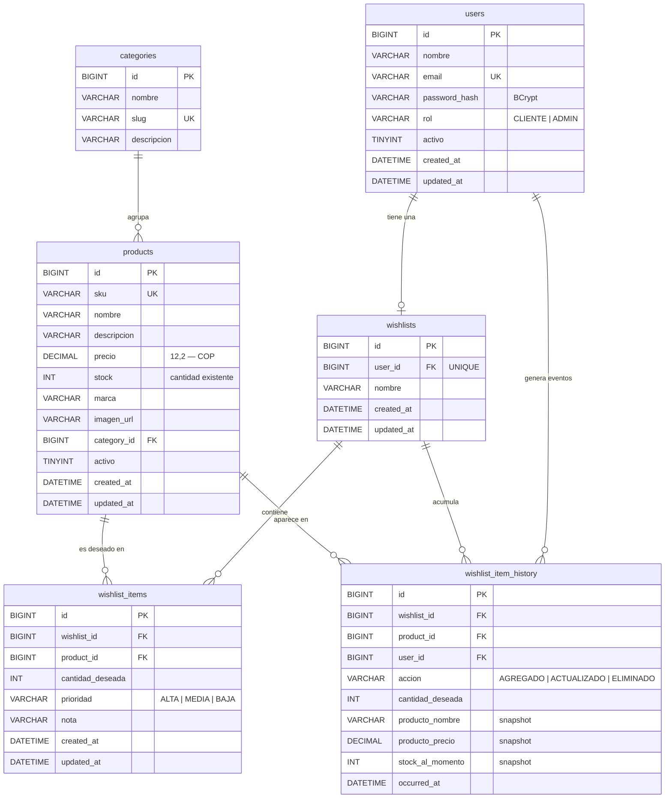

# Modelo de base de datos — Lista de Deseos

**Prueba técnica · Desarrollador Full Stack Expert · Carvajal**

Documento del modelo de datos exigido en los requisitos de la prueba.

| | |
|---|---|
| **Motor** | MySQL 8 (InnoDB) |
| **Charset** | `utf8mb4` |
| **Capa de persistencia** | ORM — Spring Data JPA + Hibernate |
| **Versionado del esquema** | Flyway (`backend/src/main/resources/db/migration`) |
| **Base de datos** | `carvajal_wishlist` |

---

## 1. Por qué una base de datos relacional

La prueba pide proponer el tipo de base de datos. La elección es **relacional (MySQL 8)** por cuatro razones concretas de este dominio:

1. **El dominio es relacional, no documental.** Producto pertenece a categoría; lista pertenece a usuario; ítem referencia producto. Son relaciones estables y bien definidas, exactamente lo que modela un esquema relacional.

2. **El stock es un dato compartido y vivo.** El requisito 3 obliga a comparar el deseo del cliente contra la cantidad existente *real*. En un modelo documental, lo natural sería embeber una copia del producto dentro de la lista de deseos, y esa copia queda desactualizada en el instante en que cambia el inventario. Con una llave foránea a `products`, el stock se lee siempre de una sola fuente de verdad.

3. **Hay reglas de unicidad que conviene delegar al motor.** Un producto no puede repetirse en la misma lista: eso es una restricción `UNIQUE (wishlist_id, product_id)`, garantizada por la base de datos incluso con peticiones concurrentes.

4. **El histórico necesita integridad referencial.** Es una tabla append-only con llaves foráneas y transacciones ACID: el registro del movimiento y el cambio en la lista ocurren en la misma transacción, o no ocurren.

> Un motor documental como MongoDB tendría sentido si el catálogo tuviera atributos muy heterogéneos por categoría, o si necesitáramos escalar escrituras masivas sin relaciones. No es el caso de este módulo.

---

## 2. Diagrama entidad-relación

---

## 3. Diccionario de datos

### 3.1 `users`

Cliente de la tienda. La prueba permite asumir que el usuario ya existe y está autenticado; la tabla se modela igual porque la lista de deseos le pertenece a alguien y porque el plus de JWT valida credenciales contra ella.

| Columna | Tipo | Restricciones | Notas |
|---|---|---|---|
| `id` | BIGINT | PK, AUTO_INCREMENT | |
| `nombre` | VARCHAR(120) | NOT NULL | |
| `email` | VARCHAR(180) | NOT NULL, UNIQUE | Identificador de login |
| `password_hash` | VARCHAR(100) | NOT NULL | Hash BCrypt, coste 10 |
| `rol` | VARCHAR(20) | NOT NULL, default `CLIENTE` | Enum persistido como texto |
| `activo` | TINYINT(1) | NOT NULL, default 1 | Baja lógica del usuario |
| `created_at` / `updated_at` | DATETIME(6) | `created_at` NOT NULL | Los llena la auditoría de JPA |

### 3.2 `categories`

Propiedad agregada para complementar la aplicación: permite filtrar el catálogo.

| Columna | Tipo | Restricciones |
|---|---|---|
| `id` | BIGINT | PK, AUTO_INCREMENT |
| `nombre` | VARCHAR(120) | NOT NULL |
| `slug` | VARCHAR(140) | NOT NULL, UNIQUE |
| `descripcion` | VARCHAR(500) | NULL |

### 3.3 `products`

La prueba exige como mínimo ID, nombre, precio y cantidad en stock. Se agregan SKU, descripción, marca, imagen y categoría para que el catálogo sea realista.

| Columna | Tipo | Restricciones | Notas |
|---|---|---|---|
| `id` | BIGINT | PK, AUTO_INCREMENT | |
| `sku` | VARCHAR(40) | NOT NULL, UNIQUE | Código de negocio |
| `nombre` | VARCHAR(180) | NOT NULL | Indexado para la búsqueda |
| `descripcion` | VARCHAR(1000) | NULL | |
| `precio` | DECIMAL(12,2) | NOT NULL, CHECK ≥ 0 | DECIMAL y no DOUBLE: con dinero no se usa coma flotante |
| `stock` | INT | NOT NULL, CHECK ≥ 0, default 0 | **Cantidad existente** (requisitos 1 y 3) |
| `marca` | VARCHAR(120) | NULL | |
| `imagen_url` | VARCHAR(500) | NULL | |
| `category_id` | BIGINT | NOT NULL, FK → `categories` | |
| `activo` | TINYINT(1) | NOT NULL, default 1 | Retiro del catálogo sin romper el histórico |
| `created_at` / `updated_at` | DATETIME(6) | | |

**Índices:** `ix_products_nombre`, `ix_products_category`, `ix_products_activo`.

### 3.4 `wishlists`

| Columna | Tipo | Restricciones | Notas |
|---|---|---|---|
| `id` | BIGINT | PK, AUTO_INCREMENT | |
| `user_id` | BIGINT | NOT NULL, **UNIQUE**, FK → `users` | Una lista por cliente |
| `nombre` | VARCHAR(120) | NOT NULL, default `Mi lista de deseos` | |
| `created_at` / `updated_at` | DATETIME(6) | | |

Se modela como entidad propia y no como una columna en `users` para poder colgarle metadatos y para dejar abierta la posibilidad de varias listas por cliente (bastaría con quitar la restricción única).

### 3.5 `wishlist_items` — estado actual de la lista

| Columna | Tipo | Restricciones | Notas |
|---|---|---|---|
| `id` | BIGINT | PK, AUTO_INCREMENT | |
| `wishlist_id` | BIGINT | NOT NULL, FK → `wishlists` | |
| `product_id` | BIGINT | NOT NULL, FK → `products` | |
| `cantidad_deseada` | INT | NOT NULL, CHECK > 0, default 1 | Se compara contra `products.stock` |
| `prioridad` | VARCHAR(10) | NOT NULL, default `MEDIA` | |
| `nota` | VARCHAR(300) | NULL | |
| `created_at` / `updated_at` | DATETIME(6) | | |

**Restricción clave:** `UNIQUE (wishlist_id, product_id)`. Convierte "agregar un producto que ya está" en un error de negocio controlado (HTTP 409) en lugar de un duplicado silencioso.

### 3.6 `wishlist_item_history` — el histórico

| Columna | Tipo | Restricciones | Notas |
|---|---|---|---|
| `id` | BIGINT | PK, AUTO_INCREMENT | |
| `wishlist_id` | BIGINT | NOT NULL, FK → `wishlists` | |
| `product_id` | BIGINT | NOT NULL, FK → `products` | |
| `user_id` | BIGINT | NOT NULL, FK → `users` | Quién hizo el movimiento |
| `accion` | VARCHAR(20) | NOT NULL | `AGREGADO` / `ACTUALIZADO` / `ELIMINADO` |
| `cantidad_deseada` | INT | NOT NULL, CHECK > 0 | Cantidad al momento del evento |
| `producto_nombre` | VARCHAR(180) | NOT NULL | **Snapshot** |
| `producto_precio` | DECIMAL(12,2) | NOT NULL | **Snapshot** |
| `stock_al_momento` | INT | NOT NULL | **Snapshot** |
| `occurred_at` | DATETIME(6) | NOT NULL | |

**Índices:** `ix_wih_wishlist_fecha (wishlist_id, occurred_at)` para el listado paginado, `ix_wih_producto` para consultas por producto.

---

## 4. Las tres decisiones de diseño que vale la pena sustentar

### 4.1 El histórico es una tabla de eventos, no un borrado lógico

El requisito dice: *"debe almacenarse el histórico de registros que hayan llegado a la lista de deseos"*. La alternativa obvia —marcar los ítems como eliminados con un `deleted_at` en `wishlist_items`— se descartó por tres problemas concretos:

- **Pierde los cambios intermedios.** Si el cliente sube la cantidad de 2 a 5 y luego a 1, un borrado lógico solo guarda el último valor. La tabla de eventos guarda los tres movimientos.
- **Rompe la restricción de unicidad.** Si el cliente elimina un producto y lo vuelve a agregar, con borrado lógico habría dos filas con el mismo `(wishlist_id, product_id)` y la restricción `UNIQUE` lo impediría.
- **Mezcla dos responsabilidades.** La tabla del estado actual se consulta en cada carga de la lista; el histórico crece sin límite y se consulta ocasionalmente. Separarlas mantiene liviana la consulta caliente.

### 4.2 El histórico guarda un snapshot del producto

`producto_nombre`, `producto_precio` y `stock_al_momento` se copian en el evento. Si mañana el producto cambia de precio o se renombra, el histórico sigue siendo fiel a lo que pasó ese día. Un histórico que se altera retroactivamente al cambiar otra tabla no es un histórico, es una vista.

### 4.3 Las llaves foráneas del histórico no tienen `ON DELETE CASCADE`

Es deliberado: el histórico es inmutable. Si alguien intenta borrar un producto que aparece en el histórico, la base de datos lo impide. Para retirar un producto del catálogo se usa `activo = 0`, no `DELETE`.

---

## 5. Trazabilidad: requisito funcional → modelo

| Requisito de la prueba | Dónde se resuelve |
|---|---|
| 1. Ver el catálogo indicando las cantidades existentes | `products.stock`, expuesto en `GET /api/v1/products` |
| 2. Listar / agregar / eliminar / actualizar deseos | `wishlist_items` + `UNIQUE (wishlist_id, product_id)` |
| 3. Notificar si un deseo ya no está en stock | Comparación `products.stock` vs `wishlist_items.cantidad_deseada`, resuelta en el enum `EstadoStock` del servidor |
| 4. Almacenar el histórico de lo que llegó a la lista | `wishlist_item_history` (append-only, con snapshot) |
| Usuario ya existente y autenticado | `users` + JWT |

---

## 6. Scripts

El esquema no se crea a mano: lo gobierna **Flyway**, que aplica las migraciones al arrancar la aplicación y deja registro de lo aplicado en la tabla `flyway_schema_history`.

| Script | Contenido |
|---|---|
| `V1__init_schema.sql` | Las 6 tablas, llaves, restricciones `CHECK` e índices |
| `V2__seed_data.sql` | Datos simulados: 2 usuarios, 5 categorías, 20 productos, 1 lista con 4 deseos y 7 eventos de histórico |

Hibernate está configurado con `ddl-auto: none`: **el ORM no toca el esquema**, solo lo consume. Esa separación evita que el modelo de la base de datos dependa de un efecto secundario del arranque de la aplicación.

Los datos simulados están armados a propósito para que los cuatro requisitos se puedan demostrar sin tocar nada:

- hay productos con stock amplio, con stock bajo y con stock en **cero**;
- la lista del cliente ya trae un deseo agotado y uno con stock insuficiente, para que la notificación del requisito 3 se vea de entrada;
- el histórico ya trae un evento `ELIMINADO`, para demostrar que el rastro de un producto permanece aunque el producto ya no esté en la lista.
